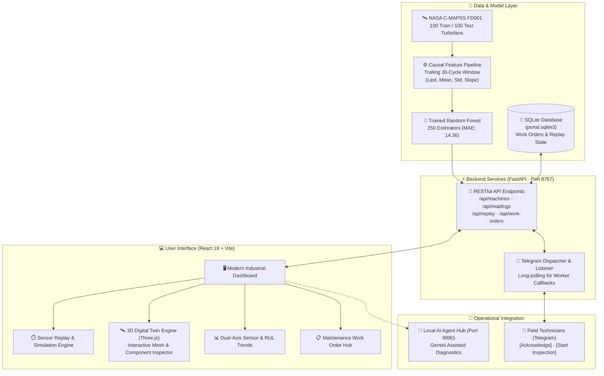

# 🛡️ Anuraksana (अनुरक्षण) — Predictive Maintenance & 3D Digital Twin Portal

<div align="center">


<br/>

[](https://react.dev/)
[](https://www.typescriptlang.org/)
[](https://vitejs.dev/)
[](https://fastapi.tiangolo.com/)
[](https://www.python.org/)
[](https://scikit-learn.org/)
[](https://www.sqlite.org/)
[](https://core.telegram.org/bots)
[](#-testing--verification)

<p align="center">
  <b>Real-Time Turbofan Health Telemetry • Causal Machine Learning RUL Estimation • Interactive 3D Digital Twin • Persistent Work Orders • Automated Telegram Incident Dispatch</b>
</p>

[Quick Start](#-quick-start-guide) • [Architecture](#-system-architecture) • [ML Performance](#-machine-learning--metrics) • [Features](#-features-deep-dive) • [5-Min Demo](#-5-minute-guided-demo) • [API Docs](#-rest-api-reference)

</div>

---

## 📖 What is Anuraksana?

**Anuraksana** (*Sanskrit:* **अनुरक्षण** — *to protect, sustain, preserve, and care for*) is an enterprise-grade **Industrial Predictive Maintenance and 3D Digital Twin Platform**. 

Developed for turbofan aircraft engines based on the **NASA C-MAPSS (Commercial Modular Aero-Propulsion System Simulation) FD001** dataset, Anuraksana bridges high-precision machine learning with real-time operational workflows. It computes Remaining Useful Life (**RUL**) in cycles, visualizes physical engine stress in an interactive 3D digital twin, manages maintenance work orders with full database persistence, and dispatches actionable alerts directly to technicians via Telegram.

> [!NOTE]
> **Zero Retraining Required:** A high-accuracy Random Forest model (250 trees) and all NASA FD001 dataset files are bundled directly in the repository for immediate offline and online execution.

---

## ⚡ Highlights at a Glance

| Feature | What It Does | Technology |
|:---|:---|:---|
| 🧠 **Causal RUL Forecasting** | Estimates remaining cycles using strictly trailing 30-cycle sensor windows (no lookahead leakage). | `Scikit-Learn`, `RandomForest` |
| 🎮 **Interactive Sensor Replay** | Step through 1, 10, or 30 engine cycles with live inference and automated fleet rotation. | `FastAPI`, `Pandas`, `NumPy` |
| 🛰️ **3D Digital Twin** | Real-time 3D turbofan inspection with cutaway views, orbit controls, and status-based casing colors. | `Three.js`, `@react-three/fiber` |
| 🔍 **Component Diagnostics** | Click-to-inspect 12 engine subsystems (HPC, Fan, Turbines, Spools) with contextual sensor telemetry. | `@react-three/drei`, `Lucide` |
| 📈 **21-Sensor Telemetry** | High-performance interactive charts for all 21 NASA sensors with dual-axis RUL overlays. | `Recharts`, `TypeScript` |
| 🚨 **Dynamic Severity Bands** | Automatic risk classification into **Critical**, **High**, **Medium**, and **Low** urgency tiers. | `Pydantic`, `FastAPI` |
| 📋 **Work Order Lifecycle** | Full drafting, approval, technician assignment, and resolution pipeline stored permanently. | `SQLite3`, `WAL Mode` |
| 📲 **Telegram Alert System** | Instant push alerts for critical machinery with in-chat **Acknowledge** & **Start Inspection** buttons. | `Telegram Bot API`, `HTTPX` |

---

## 🏗️ System Architecture



---

## 🧠 Machine Learning & Metrics

The predictive engine uses a **Random Forest Regressor** trained on the official NASA C-MAPSS FD001 dataset (High-Pressure Compressor degradation under sea-level conditions).

### 🛡️ Why Causal Feature Engineering Matters
Many predictive maintenance demos cheat by using future cycle averages or global engine parameters. **Anuraksana enforces strict causality:**
- **Zero Lookahead:** Features are calculated strictly from the **current cycle and the preceding 29 cycles** ($t_{-29} \dots t_0$).
- **Multi-Order Statistics:** For each active sensor, 4 statistical moments are derived:
  - 📌 **Last Observation** (Immediate state)
  - 📊 **Rolling Mean** (Central tendency)
  - 📉 **Rolling Standard Deviation** (Sensor noise/instability)
  - 📐 **Rolling Slope** (Linear trend rate of change)
- **Engine Split Isolation:** Hyperparameters selected using Group-Shuffle cross-validation (80/20 engine split), ensuring no data leakage between machines.

### 📊 Benchmark Comparison (Official 100 Test Engines)

| Metric | Baseline Model | Anuraksana Random Forest | Improvement |
|:---|:---:|:---:|:---:|
| **Mean Absolute Error (MAE)** | 35.92 cycles | **14.36 cycles** | 🟢 **+59.9% more accurate** |
| **Root Mean Squared Error (RMSE)** | 43.39 cycles | **19.52 cycles** | 🟢 **+55.0% error reduction** |
| **Near-Failure MAE ($RUL \le 30$)** | 70.28 cycles | **3.62 cycles** | 🚀 **+94.8% precision near end-of-life** |
| **Critical Alert Precision** | — | **95.45%** | 🎯 High true-positive rate |
| **Critical Alert Recall** | 0.00% | **84.00%** | 🛡️ Detects 84% of near-failure engines |

### 🚦 Priority & Urgency Classification

Priority is assigned using an explicit operational safety policy based on predicted RUL:

| Priority Band | RUL Threshold | Status Color | Recommended Action |
|:---:|:---:|:---:|:---|
| 🔴 **Critical** | $\le 15$ cycles | `#ac3f28` / Rose | Immediate engine stand-down; initiate priority HPC inspection |
| 🟠 **High** | $16 - 30$ cycles | `#8e601b` / Amber | Schedule inspection within current maintenance window |
| 🟡 **Medium** | $31 - 60$ cycles | `#766718` / Yellow | Monitor sensor drift rate during next operational cycle |
| 🟢 **Low** | $> 60$ cycles | `#4c7035` / Green | Machine nominal; proceed with standard operational hours |

> [!IMPORTANT]
> The displayed **Urgency Index** is calculated as:
> $$\text{Urgency} = 100 \times \text{clamp}\left(\frac{60 - \text{RUL}}{60},\; 0,\; 1\right)$$
> It represents an **operational urgency score**, not a statistical probability of instantaneous explosion or catastrophic failure.

---

## 🎮 Features Deep-Dive

### 1. 🛰️ 3D Digital Twin Engine
- Built with **Three.js** and **React Three Fiber** (`@react-three/fiber`, `@react-three/drei`).
- Loaded with a high-fidelity aircraft turbofan model (`aircraft-engine-detailed.glb`).
- **Interactive Controls:** Smooth orbit rotation, zoom, pan, reset camera, cutaway cross-section view, and visual pause.
- **Dynamic Casing State:** Turbine casing color dynamically matches current engine health (Red for Critical, Amber for High, Teal for Low).
- **Interactive Component Tree (12 Subsystems):**
  - Click directly on 3D geometry or choose from the dropdown:
    1. *Fan* &nbsp;•&nbsp; 2. *Low-Pressure Compressor (LPC)* &nbsp;•&nbsp; 3. *High-Pressure Compressor (HPC)*
    4. *Combustor* &nbsp;•&nbsp; 5. *High-Pressure Turbine (HPT)* &nbsp;•&nbsp; 6. *Low-Pressure Turbine (LPT)*
    7. *Exhaust Nozzle* &nbsp;•&nbsp; 8. *LP Shaft* &nbsp;•&nbsp; 9. *HP Shaft*
    10. *Bearings* &nbsp;•&nbsp; 11. *Accessory Gearbox* &nbsp;•&nbsp; 12. *Bypass Duct*
  - Instantly reveals linked sensor telemetry, historical trends, and engineering inspection guidelines.

### 2. 🔄 Step-by-Step Sensor Replay
- Select any machine from the 100 NASA reference engines.
- Choose step increments: **1, 10, or 30 cycles per step**.
- Watch the model recompute inference in real-time as new sensor batches arrive.
- **Auto-Rotation Mode:** Automatically rotates through high-risk engines ($RUL \le 15$) to showcase critical alert generation without manual clicking.

### 3. 📈 Multi-Sensor Telemetry & Trends
- Real-time charting across all 21 operational sensors:
  - Inlet & Outlet Temperatures (Fan, LPC, HPC, LPT in $^\circ\text{R}$)
  - Static & Total Pressures (Fan inlet, Bypass duct, HPC outlet in $\text{psia}$)
  - Rotational Speeds (Physical & corrected fan/core spools in $\text{RPM}$)
  - Fuel-Air Ratios, Bypass Ratios, Bleed Enthalpy & Coolant Bleed Rates
- Dual-axis synchronization showing sensor value progression alongside declining RUL predictions.

### 4. 📋 Persistent Work Orders (SQLite)
- Generate a formal maintenance work order with a single click from any engine review.
- Built-in status state machine:
  $$\text{Draft} \longrightarrow \text{Approved} \longrightarrow \text{In Progress} \longrightarrow \text{Completed}$$
  *(With optional cancellation prior to completion)*
- Permanent storage in `backend/data/portal.sqlite3`. Survives browser refreshes, cache clearing, and server reboots.
- Concurrency protection: optimistic timestamp verification prevents overwriting simultaneous edits.

### 5. 📲 Telegram Incident Response & Worker Workflow
- Automated alerts sent to on-call technicians when an engine enters High or Critical status.
- Direct inline interactive buttons in Telegram:
  - 🔘 **Acknowledge:** Logs worker ID and UTC acknowledgment time.
  - 🛠️ **Start Inspection:** Atomically moves approved order to `In progress` and assigns the responding technician.
- Deduped dispatch: prevents notification spamming while preserving audit history.

---

## ⚡ Quick Start Guide

### 📋 Prerequisites
- **Operating System:** Windows 10/11, macOS, or Linux
- **Node.js:** v22.12 or newer (includes `npm`)
- **Python:** 3.11, 3.12, or 3.13

---

### Option A: 1-Click Launch (Windows Recommended) 🚀

Simply double-click:
```bat
Install-and-Run.cmd
```
*This automated script will verify Node & Python, install all pinned dependencies, compile the production Vite React build, initialize the SQLite database, and launch the portal on `http://127.0.0.1:8767/`.*

---

### Option B: Manual Setup (Terminal / PowerShell / Bash) 💻

#### 1. Clone & Enter Repository
```bash
git clone https://github.com/your-username/Anuraksana_Predictive_Maintanance.git
cd Anuraksana_Predictive_Maintanance-main
```

#### 2. Install Frontend & Build Assets
```bash
npm install
npm run build
```

#### 3. Setup Python Backend Environment
```bash
# Windows
python -m venv .venv
.\.venv\Scripts\pip install -r backend/requirements.txt

# macOS / Linux
python3 -m venv .venv
source .venv/bin/activate
pip install -r backend/requirements.txt
```

#### 4. Launch Unified Portal
```bash
# Windows
.\.venv\Scripts\python run.py

# macOS / Linux
python run.py
```

Open your browser at: **[http://127.0.0.1:8767/](http://127.0.0.1:8767/)**

---

### Option C: Developer Mode (Hot-Reloading) 🛠️

Run backend and Vite hot-reloading dev server concurrently:

```bash
# Terminal 1: Backend API
python -m uvicorn app.main:app --app-dir backend --port 8767 --reload

# Terminal 2: Frontend Dev Server (Proxies /api to 8767)
npm run dev
```

---

## 📲 Telegram Bot Setup (Optional)

To enable live mobile push notifications to maintenance engineers:

1. Create a bot with [@BotFather](https://t.me/BotFather) on Telegram and copy the API token.
2. Have up to 3 workers start the bot by sending `/start`.
3. Run the interactive setup CLI:
   ```powershell
   python backend/telegram_setup.py
   ```
4. Enter your bot token and link worker chat IDs.
5. Configuration is stored locally in `backend/telegram.local.json` (*automatically gitignored*).

---

## 🧪 Testing & Verification

Anuraksana includes a comprehensive test suite covering ML feature stability, causality, API contracts, SQLite persistence, and Playwright end-to-end browser workflows.

```bash
# 1. Run Frontend Vitest Unit & Simulation Tests
npm test

# 2. Run Backend Python Unit & Integration Tests
cd backend
python -m unittest discover -s tests -v
cd ..

# 3. Build & Run Playwright End-to-End Tests
npx playwright install chromium
npm run test:e2e
```

---

## 📁 Project Structure

```
Anuraksana_Predictive_Maintanance/
├── 📂 backend/                     # Python FastAPI & Machine Learning Core
│   ├── 📂 app/                     # Web application endpoints
│   │   └── main.py                 # FastAPI router, CORS, schemas, and static server
│   ├── 📂 artifacts/               # Serialized ML models & metrics
│   │   ├── model.joblib            # Trained Random Forest model (250 trees)
│   │   ├── metrics.json            # Official MAE, RMSE, precision/recall benchmarks
│   │   ├── model_metadata.json     # Feature list, hyperparameters & train timestamp
│   │   └── test_predictions.csv    # Evaluated predictions across 100 test engines
│   ├── 📂 data/                    # Storage and dataset files
│   │   ├── 📂 raw/                 # NASA C-MAPSS FD001 dataset text files
│   │   └── portal.sqlite3          # Permanent SQLite DB for orders & sessions
│   ├── 📂 tests/                   # Python unit tests
│   │   ├── test_core.py            # Feature transformation & model tests
│   │   ├── test_integration.py     # API endpoint validation
│   │   ├── test_telegram.py        # Message formatting & alert escaping
│   │   └── test_worker_workflow.py # Telegram worker authorization tests
│   ├── ml.py                       # Training pipeline, causal feature generator
│   ├── requirements.txt            # Locked Python package dependencies
│   ├── telegram_alerts.py          # Telegram notification & polling listener
│   └── work_orders.py              # SQLite schema & work order logic
│
├── 📂 public/                      # Static assets & 3D geometry
│   ├── 📂 assets/
│   │   ├── 📂 models/
│   │   │   └── aircraft-engine-detailed.glb # 3D Turbofan GLB model
│   │   └── portal-guide.html       # Offline-accessible comprehensive guide
│   └── favicon.svg                 # Anuraksana portal branding icon
│
├── 📂 src/                         # React 19 Frontend Source
│   ├── App.tsx                     # Topbar, navigation rail, and routing shell
│   ├── components.ts               # 12 Turbofan component definitions & guidance
│   ├── MotorScene.tsx              # Three.js 3D canvas, lighting, camera & shaders
│   ├── PredictiveMaintenance.tsx   # Core dashboard: Replay, Charts, Alerts & Orders
│   ├── autoReplay.ts               # Sequential demo auto-rotation logic
│   ├── reference-theme.css         # Warm industrial color palette & typography
│   └── styles.css                  # Core component styles and responsive rules
│
├── 📂 tests/                       # Playwright Browser E2E Tests
│   ├── demo.spec.ts                # Presentation flow automation
│   ├── fd001.spec.ts               # Full FD001 portal regression suite
│   └── ml-alerts.spec.ts           # Alert verification suite
│
├── Install-and-Run.cmd             # Windows 1-click installer and launcher
├── Launch-AI-Agent.cmd             # Optional local Gemini AI assistant bridge
├── run.py                          # Unified production host (serves UI + API)
├── package.json                    # Node dependencies & build scripts
└── vite.config.ts                  # Vite build & backend proxy configuration
```

---

## 🔌 REST API Reference

The FastAPI backend exposes clean, strictly validated endpoints:

| Method | Endpoint | Description |
|:---:|:---|:---|
| `GET` | `/api/health` | Service health status and model availability |
| `GET` | `/api/machines` | List all 100 reference engines sorted by urgent RUL |
| `GET` | `/api/machines/{id}` | Detailed telemetry and latest prediction for an engine |
| `GET` | `/api/machines/{id}/history` | Historical sensor observations and rolling predictions |
| `GET` | `/api/sensors` | Metadata for all 21 NASA C-MAPSS sensors |
| `GET` | `/api/model/metrics` | Model performance benchmark JSON (MAE, RMSE, Precision) |
| `GET` | `/api/model/predictions.csv` | Download evaluation CSV for all 100 test engines |
| `POST` | `/api/replay/start` | Initialize a new sensor replay session |
| `POST` | `/api/replay/{id}/step` | Advance replay cursor by 1, 10, or 30 cycles and predict |
| `GET` | `/api/work-orders` | Fetch all saved maintenance work orders |
| `POST` | `/api/work-orders` | Create a new work order linked to engine prediction |
| `PATCH` | `/api/work-orders/{id}` | Update work order status, assignee, or notes |

---

## 🎬 5-Minute Guided Demo

Presenting Anuraksana to an audience or evaluation panel? Follow this crisp 5-minute walkthrough:

```text
⏱️ 0:00 - 1:00 │ Sensor Replay
               └─ Open "Run a demo". Select Machine 34.
               └─ Click "Start engine and run model". Show initial cycle 30 prediction (RUL ≈ 155).
               └─ Set "10 cycles per click" and advance to cycle 40. Show RUL decreasing to ≈ 149.

⏱️ 1:00 - 2:00 │ 3D Digital Twin
               └─ Switch to "3D Digital Twin". Notice status color updates in real-time.
               └─ Click "Cutaway" to reveal inner spools; orbit 360° around the engine.
               └─ Click the "High-Pressure Compressor (HPC)" to display component telemetry.

⏱️ 2:00 - 3:00 │ Telemetry & Sensor Trends
               └─ Navigate to "Sensor Trends".
               └─ Toggle Sensor 3 (HPC Outlet Temp) and Sensor 11 (Static Pressure).
               └─ Explain dual-axis correlation between sensor degradation and declining RUL.

⏱️ 3:00 - 4:00 │ Incident Alerts & Work Orders
               └─ Navigate to "Fault Alerts". Highlight Machine 34 near endpoint (RUL ≈ 6.9).
               └─ Click "Draft Work Order". Navigate to "Work orders".
               └─ Assign technician, add notes, and approve order. Show instant SQLite persistence.

⏱️ 4:00 - 5:00 │ Benchmarks & Scientific Rigor
               └─ Open "Model results". 
               └─ Contrast Anuraksana's 14.36 MAE against the 35.92 baseline.
               └─ Conclude on strict causal feature boundaries and zero lookahead leakage.
```

---

## 🛡️ Responsible Engineering & Technical Boundaries

To maintain engineering and scientific integrity:
1. **Simulated vs. Live Data:** NASA C-MAPSS FD001 is a physics-based thermodynamic simulation, not continuous IoT factory stream data. Cycles represent run-to-failure flight hours/missions, not calendar days.
2. **Causal Horizon:** Predictions require at least 30 consecutive operating cycles to populate the rolling window. The model never predicts on single isolated cycles.
3. **Dataset Scenario Prior:** FD001 models high-pressure compressor degradation specifically. Therefore, flagging the HPC for inspection is an informed **dataset contextual prior**, not an individually diagnosed bearing/fan fault.
4. **Non-Monotonicity:** In real machinery, operating conditions fluctuate; predicted RUL can fluctuate slightly between cycles as dynamic operating telemetry fluctuates.

---

## 👨‍💻 Author & Acknowledgments

- **Dataset:** NASA Prognostics Center of Excellence (PCoE) — C-MAPSS Turbofan Degradation Dataset.
- **Architected & Developed by:** The Anuraksana Engineering Team.

<div align="center">
  <sub>Built with ❤️ for aerospace reliability, industrial safety, and explainable AI.</sub>
</div>
